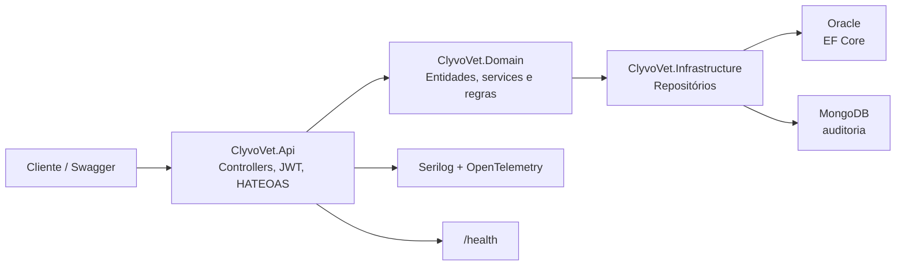

## 👥 Integrantes do Grupo (Turma 2TDSPF)
* **Enzo Vaz** - RM: 561702
* **Lucas Ryuji Fukuda** - RM: 562152
* **Pietro Donella Salomão** - RM: 561722

# 🐾 Clyvo Vet API - Challenge 2026

## 📌 Descrição do Projeto

A **Clyvo Vet API** é o backend da jornada de saúde do pet da Clyvo. Em **.NET 10** e **Clean Architecture**, ela cadastra tutores, pets, clínicas, veterinários, consultas e prontuários, com autenticação JWT, consulta paginada no padrão HATEOAS e trilha de auditoria em MongoDB.

## 🏗️ Arquitetura



| Camada | Responsabilidade |
|---|---|
| `ClyvoVet.Api` | HTTP, Swagger, JWT, HATEOAS e health checks |
| `ClyvoVet.Domain` | Entidades, regras de negócio e contratos dos repositórios |
| `ClyvoVet.Infrastructure` | Entity Framework Core (Oracle) e MongoDB |
| `ClyvoVet.UnitTests` | Services com xUnit e Moq, padrão AAA |
| `ClyvoVet.IntegrationTests` | Endpoints com `WebApplicationFactory` |

O controller não acessa o `DbContext`. Ele chama o service, o service aplica a regra e o repositório concreto persiste. Erros de validação, conflito e recurso inexistente passam por um tratador global e voltam como JSON `{ "message": "..." }`.

## 🚀 Sprint 4

* **API completa:** paginação (`page`, `pageSize`), ordenação (`sortBy`, `sortDirection`), filtro (`search` e filtros de cada recurso) e HATEOAS (`_links` com `rel`, `href` e `method`) nas consultas.
* **JWT:** `POST /api/auth/login`. Leitura exige token. Escrita respeita a role.
* **MongoDB:** cada cadastro, atualização e exclusão grava um documento na coleção `auditorias`, consultado em `GET /api/auditoria`.
* **Oracle:** Entity Framework Core com a migration `InitialCreate`.
* **Observabilidade:** health check, Serilog e OpenTelemetry, herdados da Sprint 3.

### Papéis

| Usuário | Senha | Role | O que pode fazer |
|---|---|---|---|
| `admin` | `Admin@123` | Admin | Tudo |
| `vet` | `Vet@123` | Veterinario | Leitura, pets, tutores, consultas e prontuários. Não cadastra clínica nem veterinário |
| `recepcao` | `Recep@123` | Recepcionista | Leitura, cadastro de tutor, pet e consulta. Não exclui nem altera prontuário |

Essas contas são só de demonstração.

---

# 🛠️ Instalação e execução

## Pré-requisitos

- [.NET 10 SDK](https://dotnet.microsoft.com/download/dotnet/10.0)
- Oracle acessível pela connection string
- MongoDB local, por exemplo:

```bash
docker run -d -p 27017:27017 --name clyvovet-mongo mongo:7
```

## Passo a passo

### 1. Clone

```bash
git clone https://github.com/EnzoVazz/ClyvoVet
cd ClyvoVet
```

### 2. Connection strings

Em `ClyvoVet.Api/appsettings.json`:

```json
{
  "ConnectionStrings": {
    "OracleConnection": "Data Source=SEU_SERVIDOR_ORACLE;User Id=SEU_USUARIO;Password=SUA_SENHA;",
    "MongoConnection": "mongodb://localhost:27017"
  },
  "Mongo": {
    "Database": "clyvovet"
  }
}
```

### 3. Subir a API

```bash
dotnet restore
dotnet run --project ClyvoVet.Api
```

Swagger: `http://localhost:5134/swagger`

No Swagger, chame `POST /api/auth/login`, copie o `token` e use **Authorize** com o valor `Bearer {token}`.

### 4. Testes

```bash
dotnet test
```

Os testes de integração sobem a API no ambiente `Testing`, com banco em memória e auditoria em memória. Não precisam de Oracle nem MongoDB.

---

# 🛣️ Endpoints

Consulta paginada usa `page` (padrão 1), `pageSize` (padrão 10, máximo 50), `sortBy`, `sortDirection` (`asc` ou `desc`) e `search`. A lista vazia responde `200` com `totalCount: 0`. Busca por id, CPF, CNPJ ou CRMV inexistente responde `404`.

A resposta de lista traz `items`, `page`, `pageSize`, `totalCount`, `totalPages` e `_links` (`self`, `prev`, `next`). Cada item repete `_links` para o próprio recurso e para os relacionados.

## Autenticação — `POST /api/auth/login`

Público. Corpo: `{ "username": "admin", "password": "Admin@123" }`. Resposta: `token`, `expiresAt`, `username`, `role`.

## Health — `GET /health`

Público. JSON com `Healthy`, `Degraded` ou `Unhealthy`. Em execução normal confere Oracle, MongoDB, FIAP e Google. Logs em `/logs`.

## Auditoria — `GET /api/auditoria`

Documentos NoSQL. Filtros: `entidade`, `operacao`, `search`. Ordenação padrão: data decrescente (`DataUtc`, `Entidade`, `Operacao`).

## Pets — `/api/animais`

`GET`, `POST`, `PUT`, `DELETE`. Filtros extras: `especie`, `idTutor`. Rotas: `/api/animais/especie/{especie}` e `/api/animais/tutor/{tutorId}`.

## Tutores — `/api/tutores`

`GET`, `POST`, `PUT`, `DELETE`. Busca exata: `/api/tutores/cpf/{cpf}`.

## Clínicas — `/api/clinicas`

`GET`, `POST`, `PUT`, `DELETE`. Escrita só de Admin. Busca exata: `/api/clinicas/cnpj/{cnpj}`.

## Veterinários — `/api/veterinarios`

`GET`, `POST`, `PUT`, `DELETE`. Escrita só de Admin. Busca exata: `/api/veterinarios/crmv/{crmv}`.

## Prontuários — `/api/prontuarios`

`GET`, `POST`, `PUT`, `DELETE`. Escrita de Admin e Veterinario. Busca: `/api/prontuarios/diagnostico/{termo}`.

## Consultas — `/api/consultas`

`GET`, `POST`, `PUT`, `DELETE`. Filtros: `status`, `idPet`. Rotas: `/api/consultas/status/{status}` e `/api/consultas/pet/{petId}`. Sem status no cadastro, a consulta fica `Agendada`.

---

# 📌 Status codes

| Status | Quando |
|---|---|
| `200 OK` | Consulta |
| `201 Created` | Cadastro |
| `204 No Content` | Atualização ou exclusão |
| `400 Bad Request` | Validação ou ordenação inválida |
| `401 Unauthorized` | Sem token ou credencial inválida |
| `403 Forbidden` | Token válido sem a role exigida |
| `404 Not Found` | Recurso inexistente |
| `409 Conflict` | Exclusão bloqueada por vínculo |
